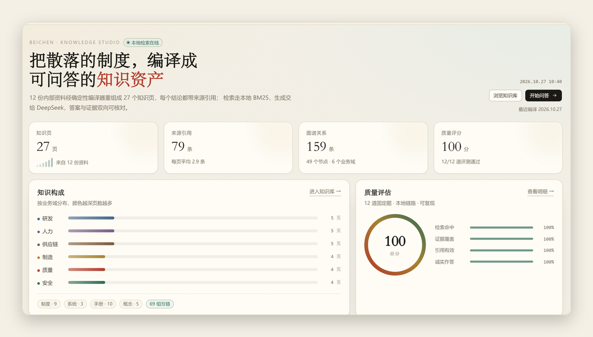

# 砚知 · 可溯源企业知识库

12 份制度文件，编译成 27 页带出处的知识页；问一句 1–2 秒，答案后面带 `[n]` 编号，点一下回到原文。

- 编译式 Wiki：按主题跨文档重组，一条结论一个来源
- 本地检索：中文二元分词 + BM25，分数低于阈值直接拒答
- 生成式问答：DeepSeek 只读本次命中的证据；没有 Key 时降级为本地摘录
- 知识图谱：49 节点 / 159 条边，按业务域成簇
- 12 道固定题的评估 + 17 个自动化测试
- 零原生依赖：数据库用 Node 24 内置的 `node:sqlite`



## 快速开始

需要 Node.js 24+ 和 pnpm。

```bash
git clone https://github.com/panday8y8/yanzhi-kb.git
cd yanzhi-kb
pnpm install
pnpm kb:init
pnpm dev
```

Windows 也可以直接跑安装脚本：

```powershell
powershell -ExecutionPolicy Bypass -File .\install.ps1
```

macOS / Linux：

```bash
bash ./install.sh
```

打开 http://localhost:3000 。端口冲突就用 `pnpm dev -- -p 3300`。

## 配置模型（可选）

```bash
# macOS / Linux
export DEEPSEEK_API_KEY=sk-你的key
pnpm dev

# Windows PowerShell
$env:DEEPSEEK_API_KEY = "sk-你的key"
pnpm dev
```

不配也能跑，问答会降级为本地证据摘录，页面上会明确标注。

## 目录

```
content/raw/     12 份原始资料（唯一事实来源，编译只读）
content/wiki/    编译产物：27 个知识页 + pages.json
lib/             编译器、检索、图谱、评估、SQLite、模型调用
app/             七个页面与 API 路由
components/      侧边栏、问答面板、图谱画布等
scripts/kb.ts    compile / graph / eval / init
tests/           17 个 node:test 用例
kb-lite.mjs      120 行最小版脚本（脱离完整工程也能跑）
```

## 常用命令

```bash
pnpm kb:compile   # 资料 → 知识页 → 证据入库
pnpm kb:graph     # 图谱抽取
pnpm kb:eval      # 12 道题评估
pnpm test         # 17 个用例
pnpm typecheck    # 类型检查
pnpm build        # 生产构建
```

## 换成你自己的资料

1. 把 Markdown 放进 `content/raw/`，格式照抄示例文件的 frontmatter。
2. 在 `content/topics.json` 里给每个 `topics` 补一个英文 slug。
3. 重新 `pnpm kb:init`。

评估题在 `lib/eval.ts`，按你的业务改成 10 来道，指标才有意义。

## 边界

- 演示版没有多租户和权限隔离，别直接放到公网；
- 图谱是规则抽取，不是模型实体识别；
- 回答依赖 DeepSeek，故障时降级为本地摘录；
- 资料里没有的内容，它不会知道，也不该假装知道。

## License

MIT

